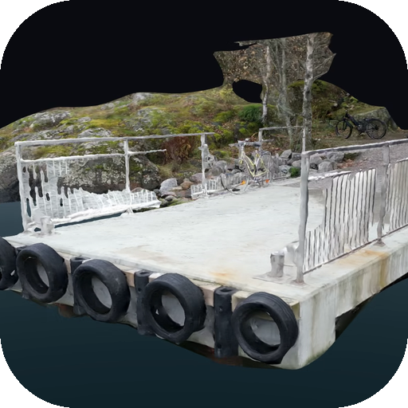
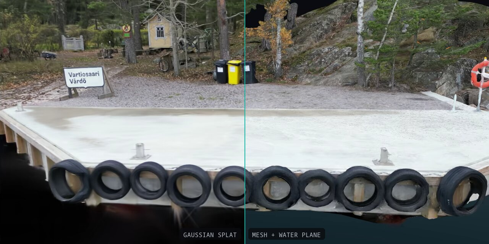

<div align="center">



# shoreline-recon

**Water-aware photogrammetry and Gaussian splatting for shoreline structures**

[](https://github.com/laurigates/shore-recon/actions/workflows/ci.yml)
[](https://github.com/laurigates/shore-recon/actions/workflows/containers.yml)
[](rust-toolchain.toml)
[](LICENSE)
[](https://github.com/laurigates/shore-recon/stargazers)



</div>

Water, sky and transient objects are masked out of every reconstruction stage; a
synthetic water plane replaces the water surface in post-processing. First datasets:
Reposalmi pier, Laajasalo and Vartiosaari sides.

M1 to M4 are implemented. Design and milestones: [docs/kickoff.md](docs/kickoff.md).
Decisions: [docs/adr/](docs/adr/).

## Features

- **Water-aware reconstruction** - Water, sky and transient objects are segmented
  and masked before SfM, dense reconstruction and splat training, and a fitted water
  plane is added back in post.
- **One clip in, v1 deliverables out** - `run` takes a capture through `frames`,
  `masks`, `sfm`, `dense`, `splat`, `post`, `video` and `export`, ending in a
  textured mesh with its water surface, a splat, showcase videos and a report.
- **Cached, reproducible stages** - Each stage's output is keyed by a fingerprint of
  its config and inputs, so a rerun with nothing changed is a cache hit
  ([ADR-0004](docs/adr/0004-stage-cache-and-manifest.md)).
- **Tools as machine configuration** - Every external tool runs natively or under
  podman, Docker or Apptainer, locally or on a remote GPU host over ssh with its
  mounts mirrored by rsync ([ADR-0003](docs/adr/0003-tool-runtimes-are-machine-config.md),
  [ADR-0009](docs/adr/0009-remote-tools-over-ssh.md)).
- **Review and delivery tooling** - A local web viewer for every export, a joined
  demo video with chapters and a seek bar, and a per-dataset download bundle.
- **Unattended batches** - `just batch` runs every dataset detached, survives
  closing the terminal, and can stop a GPU service on the host for the run.

## Tech Stack

| Category | Technology |
|---|---|
| Language | Rust (edition 2024, toolchain 1.99.1) |
| CLI | clap |
| Frame extraction | ffmpeg |
| Segmentation | OneFormer ADE20K Swin-L |
| Structure from motion | COLMAP 4.2.1 |
| Dense reconstruction | OpenMVS v2.4.0 |
| Gaussian splatting | Brush 0.3.0 |
| Rendering | gsplat 1.5.3, OpenGL, SVT-AV1 |
| Tool runtimes | native, podman, Docker, Apptainer |
| Viewer | Python 3, three.js, Spark |
| Testing | cargo-nextest, Python `unittest` |
| Task runner | just |

### Pipeline stages

| Stage | Backend | Runs on | Decisions |
|---|---|---|---|
| `frames` | ffmpeg, blur filter | this machine | [ADR-0005](docs/adr/0005-frames-stage.md) |
| `masks` | OneFormer segmentation image | this machine (Docker) | [ADR-0006](docs/adr/0006-masks-segmentation-container.md), [ADR-0007](docs/adr/0007-masks-stage-output.md) |
| `sfm` | COLMAP 4.2.1; metrics read from the model | GPU host | [ADR-0008](docs/adr/0008-v1-deliverables-and-gpu-stages.md), [ADR-0010](docs/adr/0010-sfm-metrics-from-the-model.md) |
| `dense` | OpenMVS v2.4.0, native masks, textured GLB | GPU host | [ADR-0011](docs/adr/0011-splat-and-dense-images.md) |
| `splat` | Brush 0.3.0 | GPU host | [ADR-0011](docs/adr/0011-splat-and-dense-images.md) |
| `video` | gsplat (splat) and OpenGL (mesh) renderer, AV1 plus share copies | GPU host | [ADR-0008](docs/adr/0008-v1-deliverables-and-gpu-stages.md) |
| `post` | water plane, mesh cleanup and decimation, splat floater cull | this machine | [ADR-0012](docs/adr/0012-post-stage.md) |
| `export` | deliverables and `report.json` | this machine | [ADR-0008](docs/adr/0008-v1-deliverables-and-gpu-stages.md) |

## Getting Started

### Prerequisites

- macOS on Apple Silicon for the local stages: the segmentation image is
  `linux/arm64`, and `just batch` keeps the Mac awake with `caffeinate`
- [Rust](https://rustup.rs) via rustup; `rust-toolchain.toml` pins 1.99.1, which
  rustup selects inside the repository
- [just](https://github.com/casey/just) and [cargo-nextest](https://nexte.st)
- ffmpeg and `python3`
- Docker, logged in with `docker login ghcr.io` using a token with `read:packages`
  (the tool images are private GHCR packages)
- A CUDA GPU host reachable over ssh with Apptainer, logged in with
  `apptainer registry login` using the same kind of token. The `sfm`, `dense`,
  `splat` and `video` images are `linux/amd64` built for CUDA sm_89
  ([containers/README.md](containers/README.md))

### Installation

```sh
git clone https://github.com/laurigates/shore-recon.git
cd shore-recon
cp .env.example .env   # SHORELINE_TOOLS and optional settings
just build
```

How each external tool runs is machine configuration: `configs/tools.toml` holds the
defaults, and a git-ignored host file such as `configs/<host>.local.toml` replaces
whole tool tables. Pass it as `--tools <file>` or `SHORELINE_TOOLS`. The comments in
`configs/tools.toml` document the keys, including `[<tool>.remote]` for the GPU host.

### Usage

```sh
cargo run -- config configs/reposalmi-laajasalo.toml   # resolved config
cargo run -- plan   configs/reposalmi-laajasalo.toml   # stage order
cargo run -- tools  configs/reposalmi-laajasalo.toml   # resolved tools
cargo run --release -- run configs/reposalmi-laajasalo.toml   # implemented stages
cargo run --release -- run --stage frames configs/reposalmi-laajasalo.toml
```

`run` caches each stage's output under `work/<dataset>/<stage>/<fingerprint>/`
(`--work` or `SHORELINE_WORK` moves the root). Relative paths in a config, such as
`dataset.input`, are resolved against the working directory, so run from the
repository root. Dataset configs are deep-merged over `configs/defaults.toml` in the
same directory, and unknown keys are rejected.

#### Outputs

The v1 deliverables end up in `work/<dataset>/export/<fingerprint>/`:

- `model.glb`, the mesh with its water surface, and `splat.ply`
- one video per scene and view (`splat-arc.mp4`, `splat-drone.mp4`, `mesh-arc.mp4`,
  `mesh-drone.mp4`, from `video.views`) with share copies
- a short clip per processing step (`step-1-frames.mp4` to `step-6-splat-raw.mp4`:
  frames, masks, sparse points and cameras, dense points, the mesh and the splat
  before post)
- `water_plane.json` and `report.json`

#### Processing a new capture

Copy the clip to `data/raw/<name>.mp4`, write `configs/<name>.toml` (`[dataset] name`
and `input`), then `just batch`, `just demo` and
`just bundle`. The `process-capture` project skill
(`.claude/skills/process-capture/SKILL.md`) has the whole runbook: footage checks,
timings, result checks and delivery.

#### Batch, demo and viewer

- `just batch` runs every dataset (every `configs/*.toml` with a `[dataset]` table whose
  input exists, or `SHORELINE_DATASETS`) detached and logs to `tmp/runs/`; `just batch-status` shows its
  progress. It can stop a GPU service on the host for the run (`SHORELINE_STOP_SERVICE`)
  and run a notifier when it ends (`SHORELINE_NOTIFY_CMD`; see `.env.example`).
- `just demo` joins each dataset's splat and mesh videos for every view (from its
  latest export) behind a title card into `work/demo/shoreline-recon-v1-demo.mp4`,
  with a chapter per part, a timeline bar under the picture for seeking, and a share
  copy ([ADR-0013](docs/adr/0013-demo-video-format.md)).
- `just viewer` serves a local web viewer for everything the export stage has written
  under `work/`: pick a dataset and run, orbit the splat and the mesh with its water
  plane, compare them with the splat and mesh before post, and play the videos. It
  needs only `python3` and, for three.js and Spark, network access to jsDelivr
  ([ADR-0015](docs/adr/0015-local-export-viewer.md)).
- `just bundle` zips each dataset's mesh, splat (as SPZ), water plane, report and a
  README into `work/bundle/` ([ADR-0014](docs/adr/0014-spz-splats-in-bundles.md)).

`just --list` shows every recipe.

## Project Structure

```
shore-recon/
├── crates/
│   ├── cli/          # clap entrypoint (binary: shoreline-recon)
│   ├── core/         # config, DAG, fingerprint, Stage trait, cache, pipeline, tool runner
│   └── frames/ masks/ sfm/ dense/ splat/ video/ post/ export/   # one crate per stage
├── configs/          # defaults.toml, per-dataset overrides, tools.toml
├── containers/       # Containerfiles for the tool images, pinned versions
├── docs/             # kickoff, ADRs
├── scripts/          # demo video, bundle, SPZ conversion, export viewer
├── spike/m0/         # M0 spike scripts and their justfile (just -f spike/m0/justfile)
├── tests/fixtures/   # frame and mask fixtures
├── justfile
└── rust-toolchain.toml
```

Runtime directories `work/`, `data/` and `models/` are git-ignored.

The M0 spike ran end to end with the scripts in [`spike/m0/`](spike/m0/README.md),
driven by `just` (GPU recipes need a CUDA host: see `.env.example`). Findings:
[ADR-0002](docs/adr/0002-m0-spike-findings.md).

## Development

```sh
just check   # every command below except the integration profile
cargo fmt --all --check
cargo clippy --workspace --all-targets -- -D warnings
cargo nextest run                       # unit tests
cargo nextest run --profile integration # tests named *::integration::*, need tools/GPU
python3 -m unittest discover -s scripts -p 'test_*.py'   # script tests
```

## Contributing

Work follows [CLAUDE.md](CLAUDE.md): conventional commits, a unit test with every
change (kept next to the code), `just check` before committing, external tools only
through the core `ToolRunner`, and an ADR in `docs/adr/` for each backend or format
decision.

## License

This project is licensed under the [MIT](LICENSE) license.
