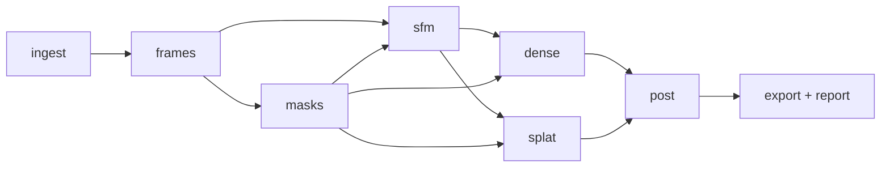

# shoreline-recon — Project Kickoff

Working name. A water-aware photogrammetry and Gaussian splatting pipeline for shoreline structures.

First datasets: Reposalmi pier, from the Laajasalo side and the Vartiosaari side.

## Background

The initial reconstructions of the Reposalmi pier failed in predictable ways:

- **Water.** Moving water and specular reflections produced false feature matches and inconsistent depth. Some reflections were reconstructed as mirrored geometry.
- **Texture.** The white concrete deck has little texture, so it yields few features.
- **Parallax.** Photos were taken from only a few positions, which gave too little parallax.

The fix is to exclude water and other unreliable regions from every reconstruction stage using per-image masks. A synthetic water plane then replaces the water surface in post-processing.

## Goals

- Single-command, reproducible runs: `shoreline-recon run <config>`.
- Automatic masking of water, sky and transient objects.
- Pluggable backends for each stage: masking, SfM, dense reconstruction and splatting.
- Outputs:
  - a mesh as GLB;
  - Gaussian splats as PLY;
  - a metrics report as JSON.
- Quality gates that fail a run when registration is poor.
- Content-addressed stage caching. A config change reruns only the affected stage and its dependents.

## Non-goals (v1)

- Reconstructing the water surface itself.
- Underwater geometry.
- Real-time or on-device processing.
- Cloud or batch execution. This is deferred to M5.
- A GUI. v1 is CLI and config only.

## Pipeline overview



| Stage  | Input                  | Output                   | Default backend                    | Alternatives                        |
|--------|------------------------|--------------------------|------------------------------------|-------------------------------------|
| frames | video / image dir      | `images/*.jpg`           | ffmpeg + blur filter               | —                                   |
| masks  | images                 | `masks/<image>.png`      | ONNX semantic segmentation (`ort`) | SAM 2 / Grounded-SAM 2 (container)  |
| sfm    | images, masks          | `sparse/0`               | COLMAP (SIFT)                      | GLOMAP; hloc (ALIKED + LightGlue)   |
| dense  | sparse, images, masks  | textured mesh            | OpenMVS                            | COLMAP MVS                          |
| splat  | sparse, images, masks  | `splat.ply`              | Brush                              | Nerfstudio splatfacto               |
| post   | mesh / splat, sparse   | cleaned mesh, water plane| Rust                               | Blender headless                    |
| export | post output            | `.glb`, `.ply`, report   | Rust                               | —                                   |

## Stage details

### frames

- **Video input.**
  - Extract frames at a configurable fps.
  - Drop blurry frames, measured by the variance of the Laplacian.
  - Drop near-duplicate frames.
- **Photo input.**
  - Copy the images and normalise EXIF orientation.
  - Preserve EXIF focal length.
- An optional cap on the long edge of each image, for example 3200 px.
- Video input is implemented as [ADR-0005](adr/0005-frames-stage.md); near-duplicates are #10 and photo input #23.

### masks

- **Naming.** Masks follow the COLMAP convention: `images/00001.jpg` → `masks/00001.jpg.png`. Black pixels are ignored.
- **Classes.** Configurable. Defaults: water, sea, river, lake, sky, person, boat (ADE20K class set).
- **Dilation.** A morphological dilation of configurable width covers reflection boundaries at the waterline.
- **Temporal refinement.** Optional, for video input. SAM 2 propagation reduces mask flicker between frames.
- **Debug output.** Mask overlays are written for manual review.
- The segmentation runs in a pinned container image, OneFormer ADE20K Swin-L on CPU; Rust does the post-processing ([ADR-0006](adr/0006-masks-segmentation-container.md)).

### sfm

- Masks are applied at feature extraction.
- **Matcher.**
  - Video input: sequential matcher with loop detection (vocabulary tree).
  - Small sets, under about 300 images: exhaustive matcher.
- Single camera model for captures from one device.
- **Low-texture surfaces.**
  - Raise `SiftExtraction.max_num_features`.
  - Enable DSP-SIFT.
  - Learned features are available as an alternative backend.
- Metrics come from `colmap model_analyzer`.

### dense / splat

- Masks must also be applied here. Otherwise the water returns as noise.
- Native mask support in OpenMVS and Brush is not yet verified. It is checked in M0.
- **Fallback if native support is missing:**
  1. Replace masked pixels before the dense stage.
  2. Filter depth and points against the masks in post.

### post

- **Water plane.** Fit a plane with RANSAC to sparse points sampled along mask boundaries at the waterline. Alternatively, set a fixed height in config.
- **Up-axis.** Align the up-axis to the water plane normal.
- **Cleanup.** Remove geometry below the water plane and small disconnected components.
- **Water mesh.** Insert the water plane as a separate mesh with its own material.
- **Decimation.** Reduce the mesh for web delivery.

### export / report

- `model.glb`
- `splat.ply`
- `report.json`, containing metrics, the config fingerprint and tool versions.

## Architecture

### Workspace

- Rust workspace with an orchestrator CLI built on `clap`.
- Stages form a DAG. Each stage implements a common trait (`crates/core/src/stage.rs`); the pipeline computes fingerprints from it ([ADR-0004](adr/0004-stage-cache-and-manifest.md)):

```rust
pub trait Stage {
    fn name(&self) -> &'static str;
    fn deps(&self) -> &[&'static str];
    /// Config that determines the output.
    fn config(&self, config: &Config) -> serde_json::Value;
    /// Implementation revision and tool versions.
    fn version(&self, ctx: &RunContext) -> Result<String>;
    /// Write outputs into `out_dir`; return tool records and metrics.
    fn run(&self, ctx: &RunContext, inputs: &Inputs, out_dir: &Path) -> Result<StageRun>;
    /// Quality gates on the recorded metrics: Err fails the run, Ok carries warnings.
    fn gate(&self, config: &Config, metrics: &Metrics) -> Result<Vec<String>>;
}
```

### Tool execution

- All external tools run through one `ToolRunner` abstraction.
- It can run a native binary or an OCI container (podman or docker).
- It records tool version, arguments and logs, so stages do not repeat process handling.
- Backends are selected in config. Each backend is a separate module behind the stage trait.
- How each tool runs (native or container, image, GPU) is machine configuration in `tools.toml`, not dataset configuration: [ADR-0003](adr/0003-tool-runtimes-are-machine-config.md).

### Caching

- Stage outputs are stored under `work/<dataset>/<stage>/<fingerprint>/`.
- A manifest records the lineage of each output. It is written last and marks the output complete; gates are re-evaluated on cached metrics ([ADR-0004](adr/0004-stage-cache-and-manifest.md)).

### Containers

- Images are pinned for COLMAP (CUDA), OpenMVS and the Python segmentation backend.
- Images are built in CI and referenced by digest.

## Repository layout

```
shoreline-recon/
├── crates/
│   ├── cli/            # clap entrypoint
│   ├── core/           # Stage trait, DAG, cache, ToolRunner, config
│   ├── frames/
│   ├── masks/          # Masker trait; onnx, sam2 backends
│   ├── sfm/            # colmap, glomap backends; model parsing
│   ├── dense/          # openmvs, colmap-mvs backends
│   ├── splat/          # brush backend
│   └── post/           # water plane, cleanup, export
├── containers/         # Containerfiles, pinned versions
├── configs/
│   ├── defaults.toml
│   ├── reposalmi-laajasalo.toml
│   └── reposalmi-vartiosaari.toml
├── docs/adr/
├── tests/fixtures/     # small image sets, golden masks, tiny COLMAP models
└── .github/workflows/
```

## Configuration

Each dataset file overrides `configs/defaults.toml`.

```toml
[dataset]
name  = "reposalmi-laajasalo"
input = "data/raw/reposalmi-laajasalo.mp4"

[frames]
fps            = 2.0
blur_threshold = 100.0
max_long_edge  = 3200

[masks]
backend   = "onnx"
model     = "models/seg-ade20k.onnx"
classes   = ["water", "sea", "river", "lake", "sky", "person", "boat"]
dilate_px = 8
temporal  = false

[sfm]
backend       = "colmap"
matcher       = "sequential"
single_camera = true
max_features  = 16384

[dense]
backend = "openmvs"

[splat]
backend = "brush"
steps   = 30000

[post]
water_plane   = "fit"    # or fixed height, e.g. 0.0
min_component = 0.01     # fraction of total faces
target_faces  = 500000

[gates]
min_registered_ratio = 0.85
max_reproj_error_px  = 1.0
```

## Testing strategy (TDD)

- **Unit tests.**
  - Config parsing and merging.
  - Fingerprinting.
  - Mask naming and path conventions.
  - COLMAP model parsing, text and binary.
  - RANSAC plane fit on synthetic points.
  - Mesh filtering on synthetic meshes.
- **Golden tests.** Masks generated from fixture images are compared to golden masks with an IoU threshold, not byte equality.
- **Synthetic ground truth.** A scene rendered in Blender has known geometry and a water plane, so geometry error can be measured.
- **Integration tests.**
  - End-to-end runs on a small fixture set of about 30 images.
  - Assertions on registered-image ratio and reprojection error.
  - Run under a separate `cargo nextest` profile, outside default CI, or on a self-hosted GPU runner.
- **Regression tests.** The `report.json` metrics are stored per fixture. CI fails if they degrade beyond tolerance.
- **CI.** `cargo fmt --check`, `clippy -D warnings`, unit and golden tests, and container builds.

## Quality gates

| Metric                                 | Source           | v1 threshold      |
|----------------------------------------|------------------|-------------------|
| Registered images / total              | `model_analyzer` | ≥ 0.85            |
| Mean reprojection error                | `model_analyzer` | ≤ 1.0 px          |
| Mean track length                      | `model_analyzer` | ≥ 3               |
| Masked fraction per image              | masks            | warn if > 0.7     |
| Geometry below water plane after post  | post             | 0                 |

## Milestones

| ID | Scope |
|----|-------|
| M0 | **Spike.** Manual run on the existing Reposalmi data with hand-assembled masks. Verify mask handling in OpenMVS and Brush. Select the segmentation model. Record decisions in `docs/adr/`. |
| M1 | **Core.** Workspace, `Stage` trait, cache and `ToolRunner`. The `frames` and `masks` stages, with tests. |
| M2 | **SfM.** COLMAP backend, model parsing, metrics and gates. |
| M3 | **Dense and splat.** OpenMVS and Brush backends. |
| M4 | **Post and export.** Water plane, cleanup, GLB export and report. |
| M5 | **Optional.** TypeScript web viewer for meshes and splats. Batch execution with Argo Workflows on GPU nodes. |

### Definition of done (v1)

- `shoreline-recon run configs/reposalmi-laajasalo.toml` produces:
  - a GLB with a water plane;
  - a splat PLY;
  - `report.json`.
- All gates pass.
- A second run with an unchanged config is a full cache hit.
- CI is green.

## Risks

| Risk | Mitigation |
|------|------------|
| Masks miss reflections at the waterline | Dilation, an exclusion band along the waterline, overlay review |
| Over-masking removes shoreline features | Per-class tuning; mask only explicitly configured classes |
| Low-texture concrete gives sparse points | Higher-resolution frames, more features, learned-feature backend |
| Mask flicker in video | Temporal refinement with SAM 2 |
| Phone scanning apps downscale or compress images | Capture with the native camera app; keep the originals |
| CUDA dependency | Brush runs on wgpu; COLMAP MVS is optional |
| Licences of segmentation model weights | Verify before selecting the default model |

## Open questions

Answers from the M0 spike are recorded in [ADR-0002](adr/0002-m0-spike-findings.md).

1. Are the original images or video available? Which device and app were used?
   *Answered: two DJI 4K/29.97 fps clips with SRT telemetry, captured 2026-10-23.*
2. Does OpenMVS support masks natively? Does Brush? What is the fallback if not?
   *Brush: yes, a `masks/` folder matched by file stem (not COLMAP naming). OpenMVS: still
   unverified; COLMAP MVS with `StereoFusion.mask_path` was used instead.*
3. Which segmentation model, and under what licence: an ADE20K-trained ONNX model or a SAM 2-based pipeline?
   *Spike used OneFormer ADE20K Swin-L (MIT) via `transformers`; the ONNX export for the `ort`
   backend is still to do.*
4. Is a local CUDA GPU available, or only a wgpu path?
   *Answered: a remote CUDA host (RTX 4090) driven over ssh; see `.claude/rules/remote-gpu-host.md`.*
5. Is the primary deliverable the mesh, the splat, or both?
6. Where are raw data and outputs stored: locally, on a NAS, or in object storage?
   *Raw data and fetched results are local under `data/` and `work/`; full intermediates stay
   on the GPU host.*

## Capture guidelines (recapture)

- **Conditions.** Calm, overcast weather. Avoid low sun on the water.
- **Camera settings.**
  - Use a circular polarizer to reduce reflections.
  - Lock exposure, white balance and focus.
- **Movement.**
  - Move in arcs and lines. Do not rotate in place.
  - Keep 60–80 % overlap between shots.
- **Angles.**
  - Shoot from multiple heights.
  - Use low angles toward the fender side.
  - Do a pass from water level, by boat or kayak, to capture the underside.
- **Context.** Include textured surroundings in frame (stones, railings, signs) to anchor alignment.
- **Format.**
  - Video: 4K, high bitrate, slow movement.
  - Stills: roughly one per second while moving.
